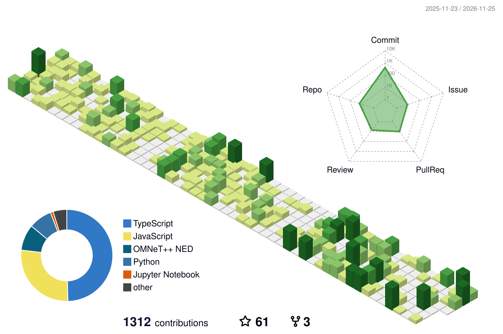

  

- **Frontend & UI Engineer** specializing in high-interactivity **React, Next.js, TypeScript, and Tailwind CSS** applications, data-intensive dashboards, and bidirectional (**RTL/LTR**) web interfaces.
- Currently building responsive public platforms, custom **React-Admin** CMS tools, and **TipTap** editorial workflows, and maintaining open-source visual programming tools (**Daad Blockly**).
-  • **Open to remote Frontend / UI roles**.

  

---

## Tech Stack

### Frontend & UI

### Testing, Design & Tooling

### Backend, Databases & Systems Languages

---

## Let's Connect

Open to **junior/mid-level remote Frontend & UI Engineer** opportunities and technical collaborations.

  
  
  
  
  

  

